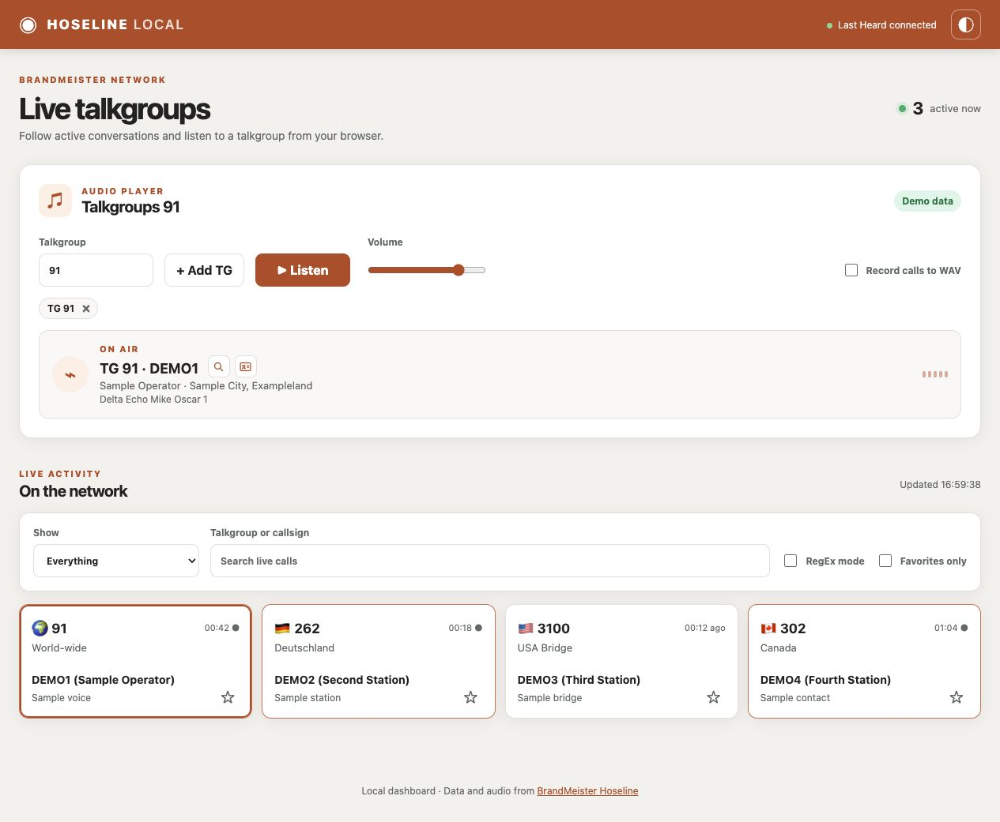
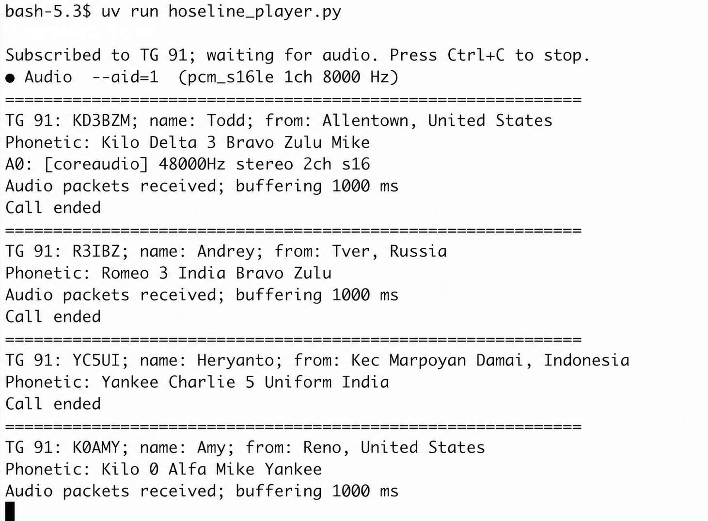

# Hoseline BM Web and Console Player

Listen to BrandMeister talkgroups in a local web dashboard or in the terminal.
The web player provides active calls, filters, browser audio, and optional WAV
recording. The console player uses `mpv` for audio playback.

[Hoseline playback flow diagram](https://github.com/shaposhnikoff/hoseline-bm-console-player/blob/main/docs/diagrams/hoseline-playback-flow.md)

## Interface preview

Watch the interface demo on YouTube:

[](https://youtube.com/shorts/05-hRPGhAFA)

The web dashboard screenshots and local walkthrough use fictional sample
callsigns and names. The local walkthrough is silent and shows search,
favorites, and theme switching.



[Dark theme screenshot](docs/media/dashboard-dark.jpg) ·
[Player and profile icons](docs/media/player-profiles.jpg) ·
[Watch the 14-second walkthrough (MP4)](docs/media/interface-walkthrough.mp4)

## Local web dashboard in Docker

The dashboard shows current and recently ended calls from BM Last Heard. You can
filter by country or region inferred from the talkgroup prefix, search
talkgroups or callsigns (including RegEx), save favorite groups, switch themes,
and click a call card to listen. Add up to four talkgroups with **+ Add TG**;
the player mixes their audio and shows the latest active callsign, name,
location when available, and phonetic callsign. Links beside a known callsign
open its QRZ.com and RadioID profiles in a new tab. Audio
plays in the **browser on your computer**; the container does not need `mpv` or
access to the host audio device.

Start Docker Desktop, then build the image in the repository directory:

```bash
docker buildx build --load -t hoseline-bm-console-player:local .
```

Run the dashboard on your computer only:

```bash
mkdir -p recordings
docker run --rm --name hoseline-local \
  --user "$(id -u):$(id -g)" \
  -p 127.0.0.1:8765:8765 \
  --mount "type=bind,src=$PWD/recordings,dst=/app/recordings" \
  hoseline-bm-console-player:local
```

Open [http://127.0.0.1:8765](http://127.0.0.1:8765), enter a talkgroup such
as `91`, add any other talkgroups, and click **Listen**. A browser click is required before audio can
start. Enable **Record calls to WAV** to save each call under `recordings/` on
the host. The checkbox takes effect immediately, restarting the selected
talkgroup connections if already listening. Recordings use the same per-call
filename format as the terminal player. Stop with Ctrl+C in the Docker terminal
or `docker stop hoseline-local` in another terminal.

For full name, city, and country lookup, mount your local BM user export. The
JSON file is intentionally excluded from the image:

```bash
docker run --rm --name hoseline-local \
  --user "$(id -u):$(id -g)" \
  -p 127.0.0.1:8765:8765 \
  --mount "type=bind,src=$PWD/recordings,dst=/app/recordings" \
  --mount "type=bind,src=$PWD/data/users.json,dst=/app/data/users.json,readonly" \
  hoseline-bm-console-player:local
```

Create `recordings/` before either command; create `data/users.json` before
using the second. Without that export, the dashboard uses available Last Heard
callsign and name data, while location may be missing. The browser stores theme
and favorite selections locally. Only the loopback port is published, so other
computers cannot open this dashboard through the shown command.

For development without Docker, run `uv run python hoseline_web.py` and open
the same local URL. The web audio path is shown in
[the dashboard flow diagram](docs/diagrams/hoseline-web-flow.md).

## Console player

**Dependency:** Install [`mpv`](https://mpv.io/) on the host and make sure it is
available on your `PATH`. Then run:

```bash
uv run --package bm-monitor python hoseline_player.py 91
```

Console output from TG 91 (local data path redacted):



The talkgroup defaults to 91 if omitted. The player reads the current Hoseline
client token from its public page, joins that talkgroup through the `spotter`
WebSocket, and plays incoming G.711 mu-law audio. Set `BM_HOSELINE_TOKEN` to
override automatic token discovery. Press Ctrl+C to stop. The player exits if
the audio connection closes. It collects one second of audio before playback to
smooth irregular packet arrival. It decodes G.711 mu-law to PCM and continuously
feeds `mpv`, inserting silence between calls so the audio device stays active.
Increase the delay with `--buffer-ms 1500` if audio still crackles. The incoming
stream is fixed at 64 kbit/s G.711 mu-law.

At call start, the player matches the Hoseline source DMR ID with
`data/users.json` and displays the registered callsign, name, city, and country.
The next console line spells the callsign using the radio phonetic alphabet,
keeping digits as digits (for example, `UT3UDX` becomes
`Uniform Tango 3 Uniform Delta X-ray`).
Each new call starts with a horizontal separator in the console.
Use `--users-json /path/to/users.json` for another export. The local JSON is
not included in this repository. It is read at startup, so restart the player
after updating it. If a record is absent,
the player uses the BM Last Heard feed for a callsign and name when they arrive;
the city and country then show as `Unknown`. If that feed fails, audio still plays.
Directory locations are registration data, not a live position.

Recording is off by default. To save each call as a separate 8 kHz mono WAV:

```bash
uv run --package bm-monitor python hoseline_player.py 91 --record
```

Files go to the ignored `recordings/` directory. Set `--record-dir /path/to/dir`
to choose another location. Filenames use
`TG<group>_<callsign>_<YYYYMMDD>_<HHMMSSffffff>.wav` in UTC, for example
`TG91_UT3UDX_20261003_153000123456.wav`. A slash in a portable callsign is
replaced with a hyphen. If the callsign is unavailable, the filename contains
`UNKNOWN`; a callsign learned during the call is added when the WAV closes.
Silence between calls is not recorded.
